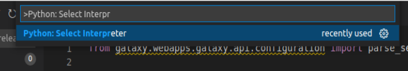
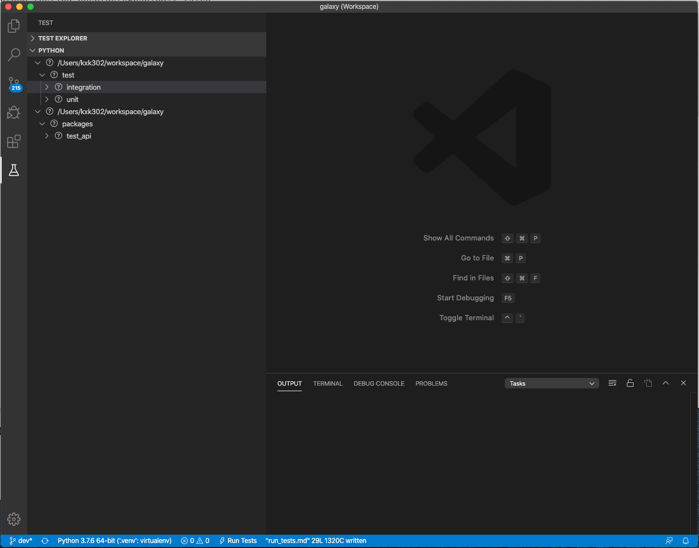

# Debugging Galaxy Tests

## Debugging Galaxy unit & integration tests in VS code

The following instructions assume that you have cloned your Galaxy fork into a local directory (referred to as `<galaxy_dir>` below) and created the `.venv` virtual environment inside it (e.g. by running `./scripts/common_startup.sh`).

1. Start VS Code
2. Install the Python extension for VS Code: select Extensions on the Activity Bar, on the far left-hand side
3. Open the Galaxy directory by selecting 'File -> Open Folder...' from the menu (or by running `code <galaxy_dir>`).
   To open a single file from the command line, pass the Galaxy directory before the file, e.g. `code <galaxy_dir> <galaxy_dir>/lib/galaxy/config/__init__.py`, which opens the file in a window for the Galaxy directory (reusing it if already open).
   Running just `code <galaxy_dir>/lib/galaxy/config/__init__.py` could instead open the file outside of the Galaxy workspace folder, where the workspace settings and the virtual environment below are ignored.
4. Add the following snippet to `<galaxy_dir>/.vscode/settings.json` (create the file if it does not already exist)

   ```json
   {
     "python.analysis.extraPaths": [
       "lib"
     ],
     "python.defaultInterpreterPath": "${workspaceFolder}/.venv/bin/python",
     "python.testing.unittestEnabled": false,
     "python.testing.pytestEnabled": true,
     "python.testing.pytestArgs": [
       "test/",
       "--ignore=test/shed_functional/",
       "--ignore=test/functional",
       "--ignore=test/unit/shed_unit/test_shed_index.py",
       "packages/test_api/"
     ]
   }
   ```

   `python.analysis.extraPaths` lets the language server resolve Galaxy's own packages, which live in the `lib/` directory and are not installed in the virtual environment.
   `.vscode/settings.json` is ignored by Git, so if you use [Git worktrees](https://git-scm.com/docs/git-worktree), copy it into each new worktree and open the worktree directory itself.
5. Reload the window (`Ctrl+Shift+P` then `>Developer: Reload Window`)
6. Check that the `.venv` Python is used as your Python interpreter: open a Python file from the Galaxy directory and look at the Python version in the status bar, at the bottom right. If a different interpreter is shown, select the right one with `Ctrl+Shift+P` then `>Python: Select Interpreter`.
   
7. Select Testing on the Activity Bar, on the far left-hand side. You should see unit and integration tests under 'Python' (as shown in the image below). It may take a few seconds for the tests to load up. If they do not, click the 'Refresh Tests' icon and wait for the tests to load.
   
8. Expand integration/unit tests, select a test to display its source code in the editor, add a breakpoint, and start the debugger by clicking on the debug icon (next to the test name)

## Debugging tests within GitHub actions

Sometimes it is necessary to debug tests that work locally. There are a few different strategies one could employ.
For the broadly filtered test workflows, a change confined to their workflow
file selects that workflow without starting the other broadly filtered suites.
Reusable workflows, which only run through `workflow_call`, have a leading
underscore; changes to one also run its callers. `_build_client.yaml` is called
by Playwright, integration Selenium, startup tests, and the tool form harness;
`_report_scheduled_result.yaml` by the unit, Tool Shed and tool framework
tests. On pull requests and pushes, these path filters load the reporter
definition and run its callers' test jobs; they do not exercise reporting.
The reporting job only runs on schedules and manual dispatches. A change
that also touches source files still runs the suites selected by those source
files. Scheduled and manually dispatched runs are independent
of these path filters.

When editing these filters, use ordered `paths` entries: include `**`, exclude
unneeded directories and `.github/workflows/**`, then include the workflow's
own file and any reusable workflows it calls. Keep the push and pull request
filters in sync. A new reusable workflow must be included in each caller's
filter so changes to it exercise the calling jobs. Narrow filters should also
include the shared configuration and scripts their jobs read.

If the YAML file has a `strategy` section that splits tests into multiple job runs, keep just the one that contains the failing test.
If the test never finishes, add `-s` to the options that `run_tests.sh` pass to `pytest` (i.e. `-s` needs to be after a `--`), so you can see live output.
The following diff adds `-s` and select a single shard from the job matrix:

```diff
diff --git a/.github/workflows/integration.yaml b/.github/workflows/integration.yaml
index 52cf06d311..6a2d90f235 100644
--- a/.github/workflows/integration.yaml
+++ b/.github/workflows/integration.yaml
@@ -98,7 +98,7 @@ jobs:
       - name: Run tests
         run: |
           . .ci/minikube-test-setup/start_services.sh
-          ./run_tests.sh --coverage -integration test/integration -- --num-shards=4 --shard-id=${{ matrix.chunk }}
+          ./run_tests.sh --coverage -integration test/integration -- -s --num-shards=4 --shard-id=1
         working-directory: 'galaxy root'
       - uses: codecov/codecov-action@v3
         with:
```

If that's not enough and you need to snoop around the process, halting it and inspecting what is going on it's helpful to log into the GitHub runner
and run the test manually. You can do this by injecting a step that inserts an SSH session via [tmate](https://github.com/mxschmitt/action-tmate#use-registered-public-ssh-keys), then use your favorite tools like py-spy or similar to look at the test while it's failing or getting stuck.

Note that you probably don't want to do this on a PR branch, where all your tests are still going to run. Instead run this only against your fork.

# Debugging tests that run out of memory

You can profile the memory used in tests by installing
[pytest-memray](https://pytest-memray.readthedocs.io/) in your virtual
environment, activating it by setting `memray = true` in `pytest.ini`, then run
the problematic tests in the usual way. After the tests finish, a report is
produced by memray.

Note that `pytest-memray` cannot profile test classes that inherit from
`unittest.TestCase` .
